# Weekender

[](https://github.com/zezekim/weekender/actions/workflows/ci-cd.yml)


**Live:** https://173.230.134.61.sslip.io

**The weekend. Sorted.** Pick any city in the world and get the Saturday–Sunday forecast, two outings for children aged 4–8 and an Italian restaurant for dinner. Every pick links to its source and shows when it was checked.

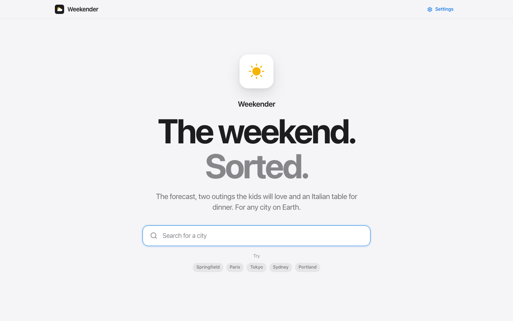

<p align="center">
  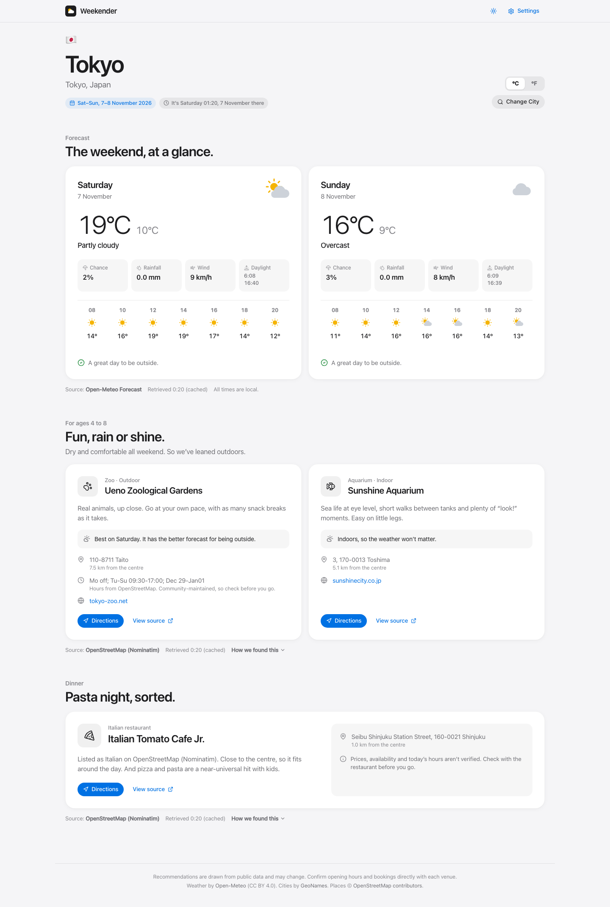
  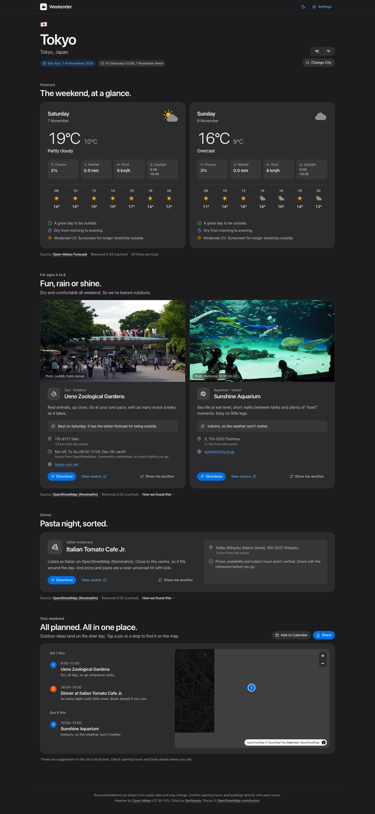
</p>

---

## Contents

- [Features](#features)
- [How it works](#how-it-works)
- [Tech stack](#tech-stack)
- [Project structure](#project-structure)
- [Quick start (local, Docker)](#quick-start-local-docker)
- [Local development without Docker](#local-development-without-docker)
- [Deploying to an Ubuntu server](#deploying-to-an-ubuntu-server)
- [CI/CD: automatic deployments](#cicd-automatic-deployments)
- [Operations: start, stop, restart, update](#operations)
- [Configuration](#configuration)
- [Services, ports and data sources](#services-ports-and-data-sources)
- [API reference](#api-reference)
- [Recommendation logic](#recommendation-logic)
- [Handling uncertainty and failures](#handling-uncertainty-and-failures)
- [Security](#security)
- [Design system](#design-system)
- [Testing and verification](#testing-and-verification)
- [Technical decisions](#technical-decisions)
- [Known limitations](#known-limitations)
- [Roadmap](#roadmap)
- [License and attribution](#license-and-attribution)

---

## Features

### City search with clear disambiguation
- Type-ahead search over every populated place in [GeoNames](https://www.geonames.org/), via the Open-Meteo Geocoding API.
- Each result shows its **region, country, flag and population**, so the 15+ places called *Springfield* are easy to tell apart. When two results share the same region and country, the county is shown too.
- Full keyboard support (↑ ↓ Enter Esc) and ARIA combobox semantics.
- The selected city is kept in the URL (`/?city=4409896`), so a plan can be shared or bookmarked.

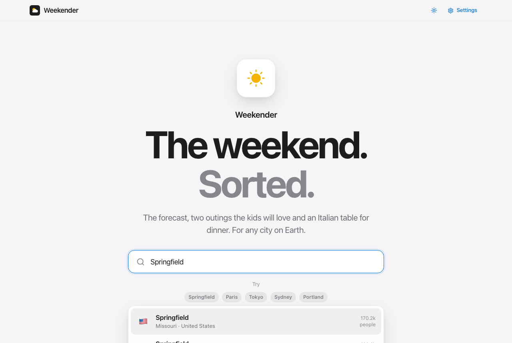

### Weekend weather
- The forecast for the **next Saturday and Sunday in the city's own local date**, from [Open-Meteo](https://open-meteo.com/):
  - on Saturday, the weekend is today and tomorrow;
  - on Sunday, it is the following weekend.
- High and low temperatures, conditions, chance of rain, rainfall, maximum wind, sunrise and sunset, and a two-hourly daytime strip from 08:00 to 20:00.
- A °C / °F toggle that also converts wind (km/h ↔ mph), rainfall (mm ↔ in) and distances (km ↔ mi). The choice is remembered on the device.
- A one-line verdict for each day ("A great day to be outside.", "Rain likely. Have a plan B.").
- **Best time outside:** the longest dry daytime stretch, worked out from the hourly forecast (for example "Best time outside: 10 AM – 2 PM", or "Dry from morning to evening").
- **UV advice** when it matters ("High UV. Pack sunscreen and hats.").

### Two activities for ages 4–8
- Real places from OpenStreetMap: children's museums, science centres, aquariums, zoos, petting farms, planetariums, indoor play centres, theme parks, playgrounds and more.
- **Weather-aware selection:**
  - Rain or cold on both days → the picks lean indoors.
  - A dry, comfortable weekend → the picks lean outdoors.
  - Mixed weather → one indoor and one outdoor idea, with the outdoor one assigned to the drier day.
- A short explanation of why each type of place suits young children, plus a note on how the weather affected the pick.
- Address, distance from the centre, website, and opening hours when the source lists them (clearly marked as community-maintained).
- **Real photos of the place itself** from Wikimedia Commons (found through the place's Wikidata link), credited with the photographer and licence. Cards fall back to an icon when no photo exists, so there are never broken images.
- **Show me another**: swap either idea for the next-best runner-up, picked from a different category first.
- An **Apple Maps** directions link and a link to the source record.

### One Italian restaurant
- Recommended only when the source **explicitly tags the cuisine as Italian** (or as a pizzeria, which is labelled honestly as such).
- If nothing can be verified, the app says so and doesn't guess.
- Family details are shown only when the listing includes them: kids' area, high chairs, outdoor seating, wheelchair access.
- A plain caveat that prices, availability and today's opening hours are not verified.
- **Show me another** cycles through other verified Italian options nearby.

### Your weekend, planned
- A **timeline**:
  - outdoor ideas land on the day with the better forecast, starting in its driest stretch;
  - indoor ideas take the other day;
  - dinner is an early Saturday evening.
- A **map** (MapLibre with OpenFreeMap vector tiles, no API key) with numbered pins that match the timeline. Tapping a stop or a pin highlights the other. The map follows the light/dark theme, and it loads only when it scrolls into view, so it adds nothing to the first page load.
- **Add to Calendar** downloads a standards-compliant `.ics` file with events in the city's own time zone, plus addresses, coordinates and source links.
- **Share** uses the phone's own share sheet, or copies the link on desktop.

<p align="center">
  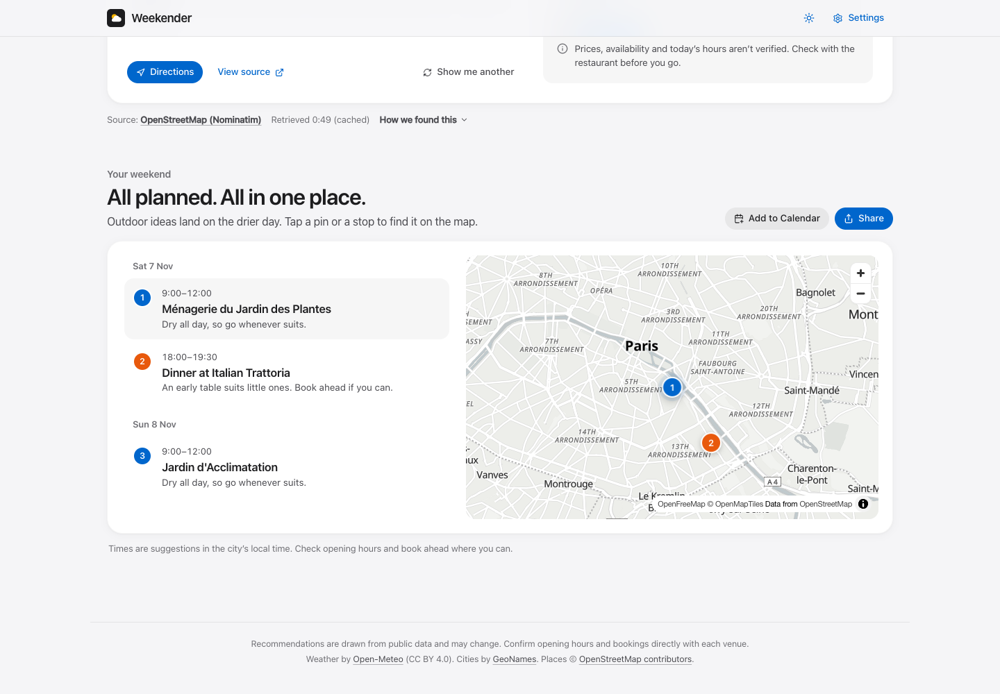
  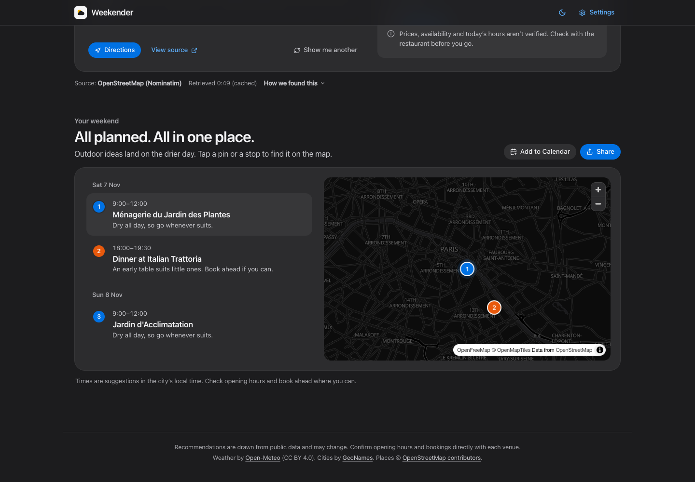
</p>

### Getting to a city faster
- **Near me** finds the closest city to the browser's location. The coordinates are rounded to about 1 km before any lookup and are never stored.
- **Recently viewed** cities appear on the home page. They are kept on the device only.
- **Popular cities are pre-loaded** in the background after every deploy and every 3 hours, so a demo of Paris, Tokyo, Sydney, Springfield or Portland is instant.

### Transparent sourcing
- Every section shows its **source** and **when the data was retrieved**, and whether it came from the cache.
- If a source is down but a recent result exists, the app shows that result **clearly labelled**: *"Live source unavailable. Showing the last saved results."*, with the original retrieval time.
- A **"How we found this"** panel lists every provider that was tried and what happened, for example *"Overpass: all servers timed out → Nominatim: used for these results"*.

### Protected Settings page
Signed in through **Authelia**. From there you can:
- add, replace or remove API keys (the browser only ever sees `••••abcd`);
- choose the preferred places provider (Auto, Geoapify, Google, OSM only);
- edit the Overpass mirror list and the contact email sent to OpenStreetMap;
- run live connection checks for each data source;
- **simulate outages** of geocoding, weather or places, to show the failure handling.

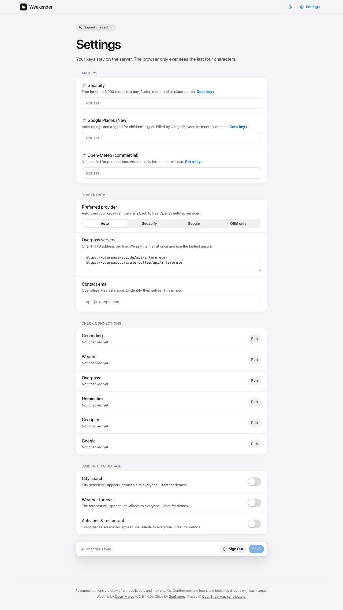

### Polished UI
- Light and dark themes. The theme follows the system setting until you pick one with the toggle in the top bar, then remembers your choice.
- Motion built with Framer Motion:
  - masked headline reveals and a cycling weather glyph;
  - temperatures that count up;
  - staggered hourly forecasts and content that rises in as you scroll;
  - gentle hover lift on cards.
- Motion is switched off automatically for users who prefer reduced motion.
- Responsive from 320 px phones to wide desktops, with no horizontal scrolling.
- **Installable as an app**, with a web manifest, home-screen icons and a service worker. The app shell works offline; data always comes live from the server.
- **Accessible:** WCAG 2.1 AA colour contrast in both themes and keyboard-reachable scroll areas, checked automatically with axe on every push.
- Skeleton loaders, a "still looking…" message on slow loads, and friendly empty and error states with a **Try Again** button.

<p align="center">
  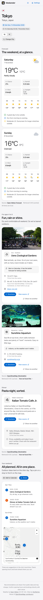
  &nbsp;
  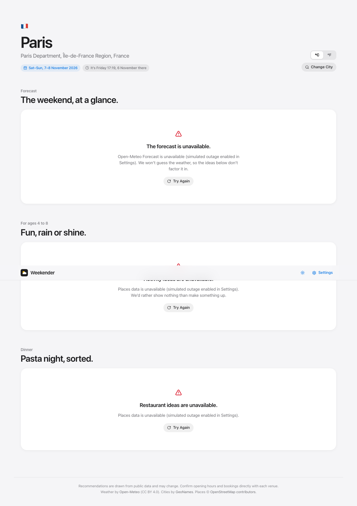
</p>

---

## How it works

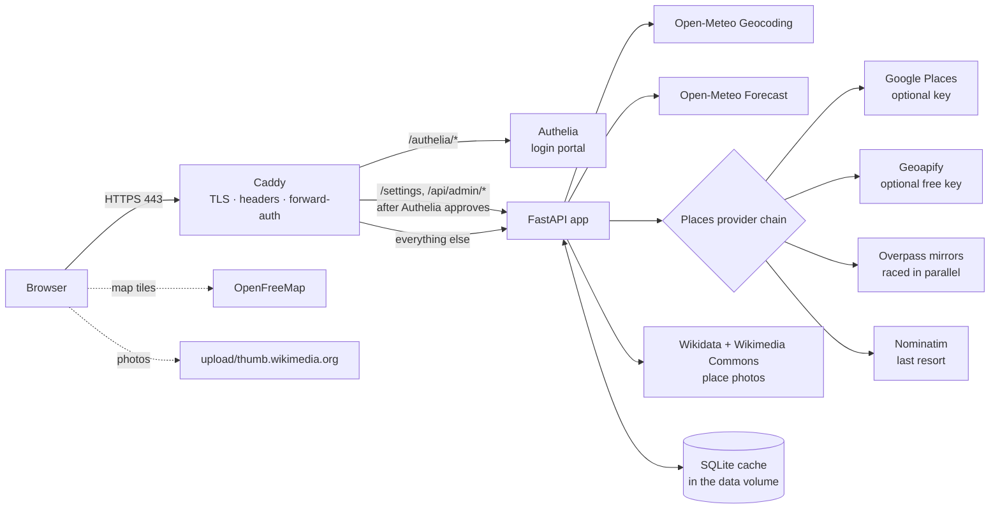

1. The browser loads the React single-page app, which is served by FastAPI behind Caddy.
2. When a city is chosen, the UI first requests `/api/cities/{id}`. That returns the city, its local time and the target weekend dates.
3. The **weather**, **activities** and **restaurant** sections then load **in parallel**, each with its own loading, error and empty state. A slow places provider never holds up the forecast.
4. The activities endpoint reuses the cached forecast so it can lean indoor or outdoor.
5. Places requests go through a **provider chain**. A provider that fails is skipped for 3 minutes (a circuit breaker), so every visitor isn't kept waiting on the same timeout.
6. Everything is cached in **SQLite in the data volume**, so results survive restarts and deploys. When a source fails, the last good result is served and labelled as saved rather than live.
7. The picks and runners-up get **photos** from Wikidata and Wikimedia Commons in one batched lookup, cached for a week.

---

## Tech stack

| Layer | Choice | Why |
|---|---|---|
| Backend | **Python 3.12, FastAPI, httpx (async), Pydantic** | Mostly API calls plus scoring rules; async lets three sections load concurrently |
| Frontend | **React 18, TypeScript, Vite, Framer Motion, MapLibre GL, lucide-react, Inter (self-hosted)** | Typed, fast builds, polished motion, a key-free vector map, no third-party CDNs |
| Cache | **SQLite** (in the data volume) | Survives restarts and deploys; enables a "last known good" fallback |
| Reverse proxy | **Caddy 2.8** | Automatic HTTPS (Let's Encrypt or local CA), simple `forward_auth`, security headers |
| Auth | **Authelia 4.39** | Battle-tested SSO portal; file-based user with argon2id password hash |
| Runtime | **Docker Compose** | One command to run; `restart: unless-stopped` keeps it alive |
| Tests | **pytest** (unit), **Playwright + axe-core** (browser and accessibility), **Lighthouse CI** | Logic correctness, real-browser behaviour, WCAG AA, performance budgets |

---

## Project structure

```
.
├── backend/
│   ├── app/
│   │   ├── main.py              # FastAPI routes, SPA serving, admin API
│   │   ├── core.py              # shared HTTP client, SQLite cache with stale fallback, SourceError
│   │   ├── settings_store.py    # runtime settings (JSON file, 0600) with env fallbacks + masking
│   │   ├── weekend.py           # "next Saturday on or after today" rule
│   │   ├── recommend.py         # classification, weather-aware scoring, explanations
│   │   └── providers/
│   │       ├── geocoding.py     # Open-Meteo geocoding (search + get by id)
│   │       ├── weather.py       # Open-Meteo forecast + WMO code mapping
│   │       ├── osm.py           # Overpass (mirror race) + Nominatim (throttled)
│   │       ├── keyed.py         # Geoapify + Google Places (New)
│   │       ├── photos.py        # Wikidata P18 → Wikimedia Commons photos with credits
│   │       └── places.py        # provider chain + circuit breaker
│   ├── tests/test_logic.py      # weekend rule, scoring, best window, alternates, cache fallback
│   └── requirements.txt
├── frontend/
│   ├── src/
│   │   ├── App.tsx              # shell, nav, theme toggle, routes
│   │   ├── theme.tsx            # light/dark toggle (system → user choice)
│   │   ├── plan.ts              # weekend timeline + iCalendar export
│   │   ├── recent.ts            # recently viewed cities (device only)
│   │   ├── api.ts               # fetch wrapper + useApi hook
│   │   ├── format.ts            # dates in city time, unit conversion, flags
│   │   ├── styles.css           # design tokens + components
│   │   ├── components/          # CitySearch, WeatherSection, places, PlanSection, MapView, WeatherIcon, ui
│   │   └── pages/               # Planner (home + city), Settings
│   ├── public/                  # favicon, app icons, web manifest, service worker
│   └── package.json
├── e2e/                         # Playwright + axe browser tests (run in CI)
├── .github/
│   ├── workflows/ci-cd.yml      # test → image → e2e → GHCR → deploy → Lighthouse
│   ├── dependabot.yml           # weekly dependency PRs
│   └── lighthouserc.json        # Lighthouse budgets
├── authelia/configuration.yml   # no secrets; domain injected via template filter
├── Caddyfile
├── docker-compose.yml
├── Dockerfile                   # multi-stage: Node build → Python runtime (non-root)
├── scripts/
│   ├── setup.sh                 # .env, Authelia secrets, admin user, data dirs
│   ├── server-bootstrap.sh      # fresh Ubuntu: Docker, swap, app user, firewall, deploy key
│   └── deploy.sh                # pull the tested image, health-check, roll back on failure
├── docs/screenshots/
├── .env.example
└── VERIFICATION.md
```

---

## Quick start (local, Docker)

**Prerequisites:** Docker Desktop (or Docker Engine) with Compose v2, and `openssl`.

```bash
git clone https://github.com/zezekim/weekender.git
cd weekender

scripts/setup.sh                 # creates .env, Authelia secrets and an "admin" user
docker compose up -d --build
```

Open **https://weekender.localhost**. Caddy issues a certificate from its own local CA, so accept the browser warning once. Browsers resolve `*.localhost` to your machine automatically.

- The setup script **prints the admin password once**. To choose your own:
  `ADMIN_USER=admin ADMIN_PASSWORD='something-long' scripts/setup.sh`
- Settings are at **https://weekender.localhost/settings**. You will be redirected to the Authelia login.
- Ports 80 and 443 must be free on your machine.

---

## Local development without Docker

```bash
# Backend (http://localhost:8077)
cd backend
python3.12 -m venv .venv && .venv/bin/pip install -r requirements.txt pytest
DATA_DIR=./.data ADMIN_AUTH_DISABLED=1 .venv/bin/uvicorn app.main:app --port 8077 --reload

# Frontend (http://localhost:5173, proxies /api to :8077)
cd frontend
npm install
npm run dev
```

`ADMIN_AUTH_DISABLED=1` lets you open the Settings API without Authelia. **Use it only for local development**; it is never set in Docker.

---

## Deploying to an Ubuntu server

Tested on Ubuntu 24.04 LTS (1 vCPU, 2 GB RAM).

### 1. Prepare the server (once, as root)

```bash
ssh root@SERVER_IP
curl -fsSLO https://raw.githubusercontent.com/zezekim/weekender/main/scripts/server-bootstrap.sh
REPO_URL=https://github.com/zezekim/weekender.git \
DEPLOY_PUBKEY="ssh-ed25519 AAAA… github-actions-deploy" \
bash server-bootstrap.sh
```

`server-bootstrap.sh`:
- installs Docker Engine and the Compose plugin from Docker's official apt repository, and enables the daemon at boot;
- adds 2 GB of swap if the machine has less than 1.5 GB, so image builds don't run out of memory;
- creates an unprivileged `weekender` user, adds it to the `docker` group and clones the repository to `/opt/weekender`;
- installs the **CI deploy key as a forced command**: that key can run `scripts/deploy.sh` and nothing else (no shell, no port forwarding, no pty);
- enables **ufw**, allowing only **22/tcp, 80/tcp, 443/tcp and 443/udp**. SSH is allowed first, so you can't lock yourself out.

It **does not** touch root's password, SSH keys or `sshd_config`.

### 2. Configure and start (once, as `weekender`)

```bash
sudo -iu weekender
cd /opt/weekender
cp .env.example .env
sed -i 's/^APP_DOMAIN=.*/APP_DOMAIN=SERVER_IP.sslip.io/; s/^TLS_MODE=.*/TLS_MODE=acme/' .env
ADMIN_PASSWORD='choose-a-long-password' scripts/setup.sh
scripts/deploy.sh
```

The app is then served at `https://SERVER_IP.sslip.io`, with a publicly trusted certificate that Caddy obtains and renews automatically. Visiting `http://SERVER_IP` redirects there.

**Why a hostname rather than a bare IP?** Authelia's session cookies need a domain, and browsers won't attach cookies to IP addresses that way. [sslip.io](https://sslip.io) maps `203.0.113.10.sslip.io` to `203.0.113.10` with no DNS setup, and certificate authorities will issue real certificates for it.

---

## CI/CD: automatic deployments

Every push to `main` is tested and then deployed to the server automatically. Pull requests run the same checks but are never deployed.

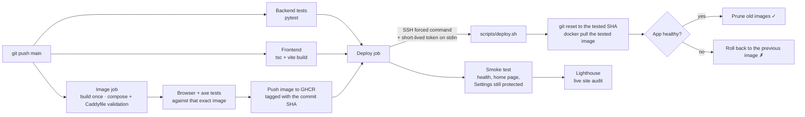

Workflow: [`.github/workflows/ci-cd.yml`](.github/workflows/ci-cd.yml)

| Job | Runs on | What it checks |
|---|---|---|
| **Backend tests** | push, PR | `pytest` on Python 3.12: weekend rule, scoring, best window, alternates, cache fallback |
| **Frontend** | push, PR | `npm ci`, TypeScript type-check and production build on Node 22 |
| **Image, browser & accessibility tests** | push, PR | Validates `docker-compose.yml` and the Caddyfile (both TLS modes), builds the app image once (with layer caching), runs it, then runs the **Playwright + axe** suite against it. On `main` it pushes the image to **GHCR** (`ghcr.io/zezekim/weekender-app:<sha>`). |
| **Deploy** | push to `main` only, after all three pass | SSH deploy of the tested image, plus a post-deploy smoke test |
| **Lighthouse** | after each deploy | Audits the live home and city pages (3 runs each). Accessibility below 95 fails the run; performance, best practices and SEO warn. The report is uploaded as a public link. |

[Dependabot](.github/dependabot.yml) opens weekly pull requests for pip, npm, Docker and GitHub Actions updates. Each one runs the full suite before it can merge.

### How the deploy works

1. The deploy job connects as `weekender@SERVER` with a dedicated ed25519 key. The server's host key is pinned in a secret, and `StrictHostKeyChecking=yes` is set.
2. On the server, that key is restricted in `authorized_keys` to `command="/opt/weekender/scripts/deploy.sh"`. Even if the key leaked, it could only trigger a redeploy of code that is already on `main`.
3. The workflow passes the **commit SHA that passed CI** as the SSH command. `deploy.sh` accepts it only if it is a full SHA that exists on `origin/main`.
4. The job's **short-lived `GITHUB_TOKEN`** (read-only for packages) goes over **stdin**, so it never appears in a command line or log. The server uses it once to pull `weekender-app:<sha>` from GHCR, then logs out. The token expires when the job ends.
5. `deploy.sh` then:
   - takes a lock, so only one deploy runs at a time;
   - resets the checkout to that commit;
   - keeps the running image as `weekender-app:previous`, then switches to the tested image;
   - if the registry can't be reached, it falls back to building on the server;
   - waits up to 3 minutes for the app's health check to pass;
   - on success, prunes old images; on failure, **rolls back** to the previous commit and image (no rebuild needed) and fails the job.
6. The smoke test checks `/api/health` and the home page over public HTTPS, and confirms the Settings API still returns 401/302 without a login. Lighthouse then audits the live site.

`.env`, the Authelia secrets and `data/` are git-ignored, so deploys never touch configuration or saved settings.

### Repository secrets and variables

| Name | Kind | Value |
|---|---|---|
| `DEPLOY_SSH_KEY` | secret | Private half of the deploy key |
| `DEPLOY_KNOWN_HOSTS` | secret | Output of `ssh-keyscan SERVER_IP` |
| `DEPLOY_HOST` | secret | Server IP |
| `DEPLOY_USER` | secret | `weekender` |
| `APP_DOMAIN` | variable | e.g. `173.230.134.61.sslip.io`, used for the environment URL and smoke test |

### Manual deploys and rotating the key

- **Re-run a deploy:** Actions → CI/CD → *Run workflow*, or on the server `sudo -iu weekender /opt/weekender/scripts/deploy.sh`. Run by hand, it has no registry token, so it builds on the server.
- **Rotate the key:**
  1. `ssh-keygen -t ed25519 -f deploy_key -N ""`
  2. Replace the line in `/home/weekender/.ssh/authorized_keys`, keeping the `command=…` prefix.
  3. `gh secret set DEPLOY_SSH_KEY < deploy_key`

---

## Operations

| Task | Command |
|---|---|
| Start or rebuild everything | `docker compose up -d --build` |
| Restart only the app | `docker compose restart app` |
| Stop | `docker compose down` |
| Status and health | `docker compose ps` |
| Follow logs | `docker compose logs -f app` (or `caddy`, `authelia`) |
| Update to the latest code | automatic on push to `main`, or `scripts/deploy.sh` |
| Clear cached results | Settings → Save, or `docker compose restart app` |
| Reset the admin password | delete `authelia/users_database.yml`, re-run `scripts/setup.sh`, then `docker compose restart authelia` |

### Staying up after logout and reboot
The containers are managed by the **Docker daemon** (a systemd service enabled at boot), not by your SSH session. Every service uses `restart: unless-stopped`, so the app survives logout, crashes and reboots. The app container also has a Docker `HEALTHCHECK` on `/api/health`.

---

## Configuration

All configuration is in `.env`, which is git-ignored and created from `.env.example`. API keys can also be set from the Settings page; values saved there take precedence over `.env`.

| Variable | Default | Description |
|---|---|---|
| `APP_DOMAIN` | `weekender.localhost` | Public hostname used by Caddy and Authelia |
| `TLS_MODE` | `internal` | `internal` = Caddy's local CA (local development); `acme` = publicly trusted certificate (server) |
| `PUID` / `PGID` | set by `setup.sh` | Unprivileged UID/GID that the app and Authelia run as |
| `GEOAPIFY_API_KEY` | – | Optional. Free tier, 3,000 requests a day |
| `GOOGLE_PLACES_API_KEY` | – | Optional. **Billed** beyond Google's free monthly usage |
| `OPEN_METEO_API_KEY` | – | Optional. Only needed for commercial use |
| `PLACES_PROVIDER` | `auto` | `auto`, `geoapify`, `google` or `osm` |
| `CONTACT_EMAIL` | – | Added to the User-Agent sent to OpenStreetMap services, as their usage policy asks |

Runtime settings are stored in `data/app/settings.json` (mode `0600`). Authelia secrets are in `authelia/secrets/` (mode `0600`) and are generated by `setup.sh`.

---

## Services, ports and data sources

### Services

| Service | Image | Exposed | Role |
|---|---|---|---|
| `caddy` | `caddy:2.8.4-alpine` | **80, 443 (tcp and udp)** | TLS, HTTP→HTTPS redirect, security headers, forward-auth |
| `authelia` | `authelia/authelia:4.39` | internal only | Login portal at `/authelia` |
| `app` | built from `Dockerfile` | internal only (`:8000`) | FastAPI API and the built React app |

### Data sources

| Source | Key | Used for | Notes |
|---|---|---|---|
| [Open-Meteo Geocoding](https://open-meteo.com/en/docs/geocoding-api) | none | City search, coordinates, time zone | GeoNames data |
| [Open-Meteo Forecast](https://open-meteo.com/) | none (optional commercial key) | Daily and hourly forecast | CC BY 4.0 |
| [OpenStreetMap Overpass](https://wiki.openstreetmap.org/wiki/Overpass_API) | none | Activities and restaurants, by tag | Mirrors are raced in parallel with a 10 s budget |
| [OpenStreetMap Nominatim](https://nominatim.org/) | none | Fallback place search | Throttled to 1 request per second, per its usage policy |
| [Geoapify Places](https://www.geoapify.com/places-api/) | free key | Faster, more reliable place search | OSM-based |
| [Google Places (New)](https://developers.google.com/maps/documentation/places/web-service) | paid key | Ratings and a "good for children" flag | Opt-in |
| [Wikidata](https://www.wikidata.org/) + [Wikimedia Commons](https://commons.wikimedia.org/) | none | Photos of the exact place, with author and licence | Only for places whose OSM record links to Wikidata |
| [OpenFreeMap](https://openfreemap.org/) | none | Vector map tiles (`positron` and `dark` styles) | Loaded by the browser |
| Nominatim reverse geocoding | none | "Near me" → nearest locality | Coordinates rounded to about 1 km, never stored |

### Caching

Everything is cached in SQLite (`data/app/cache.sqlite3`), so results survive restarts and deploys.

| Data | Fresh for | Then, if the source is down |
|---|---|---|
| Geocoding | 24 h | — |
| Forecast | 30 min | the last forecast, up to 12 h old, labelled as saved |
| Places | 6 h | the last results, up to 14 days old, labelled as saved |
| Photos | 7 days | up to 60 days |

Failures are never cached. The "Retrieved" time always shows when the data was originally fetched.

Popular cities (Paris, Tokyo, Sydney, Springfield MO, Portland OR) are **pre-loaded** 15 s after start-up and every 3 hours. Set `PREWARM_CITIES` to a comma-separated list of GeoNames IDs to change them, or to an empty value to switch it off.

---|---|
| Geocoding | 24 h |
| Forecast | 30 min |
| Places | 6 h |

Failures are never cached. The "Retrieved" time always shows when the data was originally fetched, not when it was served from the cache.

---

## API reference

All endpoints return JSON. When a source fails, the response is **HTTP 503** with `{ "error": "source_unavailable", "source": "...", "message": "..." }`.

| Method | Path | Description |
|---|---|---|
| `GET` | `/api/health` | Liveness check |
| `GET` | `/api/cities?q=Springfield` | City search (up to 10 results) |
| `GET` | `/api/cities/nearest?lat=&lon=` | Nearest city to coordinates (for "Near me") |
| `GET` | `/api/cities/{id}` | City, its local time and the target weekend dates |
| `GET` | `/api/cities/{id}/weather` | Saturday and Sunday forecast with best outdoor window and UV note, units, source, retrieval time and stale flag |
| `GET` | `/api/cities/{id}/activities` | Two picks plus runners-up (`alternates`), photos, weather summary, provider attempts, stale flag |
| `GET` | `/api/cities/{id}/restaurant` | One verified Italian pick (or `none_found`) plus alternates, photos, provider attempts |
| `GET` | `/api/admin/settings` 🔒 | Current settings (secrets masked) |
| `PUT` | `/api/admin/settings` 🔒 | Partial update. For secrets: `null` keeps the value, `""` clears it, a string sets it |
| `POST` | `/api/admin/test/{source}` 🔒 | Live check: `geocoding`, `weather`, `overpass`, `nominatim`, `geoapify` or `google` |
| `POST` | `/api/admin/cache/clear` 🔒 | Clear the in-memory cache |

🔒 = only reachable after an Authelia login.

---

## Recommendation logic

### Weekend rule
```python
saturday = today + timedelta(days=(5 - today.weekday()) % 7)   # Mon=0 … Sun=6
```
`today` is the **city's** local date, not the server's. The rule gives:

| City's local day | Weekend shown |
|---|---|
| Monday–Friday | the coming Saturday and Sunday |
| Saturday | today and tomorrow |
| Sunday | next Saturday and Sunday |

The year boundary is covered by a test.

### Weather assessment (per day)
- **wet:** the conditions are rain, snow or a storm, *or* the chance of rain is at least 50 %, *or* rainfall is at least 2 mm.
- **cold:** the high is below 5 °C. **hot:** the high is above 32 °C.
- **outdoor-friendly:** none of the above.

### Activity scoring
1. Classify each OSM place into one of 14 categories using its tags (`tourism`, `leisure`, `amenity`, `museum`, `zoo`) and multilingual name hints. General art and history museums are deliberately **excluded**.
2. Score each place. The score starts from the category's base and is then adjusted:
   - **+** if the place is notable (has a Wikidata or Wikipedia link), has a website or has an address;
   - **+** for a Google rating, if available;
   - **±** for the weather: up to +4 for indoor places in wet weather, or +2 for outdoor places on a fine weekend;
   - **−** for distance beyond 3 km from the centre.
3. Pick the top two from **different categories**. In mixed weather, force one indoor and one outdoor pick.

### Restaurant scoring
- A place must be **verified Italian** (`cuisine` contains `italian`), or else a pizzeria with a lower score. Otherwise it is excluded.
- The score then improves for a website, listed hours, an address, a kids' area or high chairs, outdoor seating and a Google rating. It drops with distance beyond 1.5 km.

### Explanations
Explanations are built from rules, **not generated by a language model**. Each sentence is one of two kinds:
- **General guidance about the type of place**, for example "Sea life at eye level, short walks between tanks…".
- **A fact from the source data**, for example "Listed as Italian on OpenStreetMap", or the high chairs and outdoor seating noted in the listing.

Nothing about opening hours, prices or availability is ever made up.

---

## Handling uncertainty and failures

| Situation | What the user sees |
|---|---|
| The weather API is down | "The forecast is unavailable." with the reason and a Try Again button. Activities are still recommended, with the note *"doesn't factor in the weather"*. |
| Overpass is down | A clean fallback to Nominatim. "How we found this" shows each failed attempt. |
| Every places source is down | "Activity ideas are unavailable. We'd rather show nothing than make something up." |
| No verified Italian restaurant | "No verified Italian spot nearby… So we won't pretend we did." |
| Fewer than two suitable activities | The ones that were found, plus "We could only find one good match." |
| Opening hours come from OSM | Labelled *"Community-maintained, so check before you go."* |
| A slow response (> 8 s) | "Still looking. The free map servers are busy right now…" |
| A source is down, but a recent result is saved | That result, labelled *"Live source unavailable. Showing the last saved results."*, with its original retrieval time |
| No photo exists, or it fails to load | The card quietly shows its icon instead. Never a broken image. |
| The map can't load (no WebGL) | "The map couldn't load on this device. Every place still has a Directions link." |

The **simulate an outage** switches in Settings trigger any of these on demand.

---

## Security

- **Only Caddy publishes ports.** The app and Authelia are only reachable on Docker's internal network.
- **Least privilege:**
  - The app and Authelia run as an **unprivileged UID** (the owner of the checkout); the app image's default user is `10001`.
  - Every container uses `cap_drop: [ALL]` and `no-new-privileges`. Caddy only adds `NET_BIND_SERVICE`.
  - The app and Caddy have **read-only root filesystems**. Authelia's startup checks need a writable one; it still runs non-root with no capabilities.
- **Settings protection:**
  - Caddy sends `/settings` and `/api/admin/*` through Authelia's `forward_auth`.
  - Caddy **strips any `Remote-User` / `Remote-*` headers sent by the client**, and the admin API requires the `Remote-User` header that Authelia sets. A forged header is rejected (tested).
  - Authelia rate-limits logins: 5 attempts in 2 minutes leads to a 10-minute ban. Passwords are hashed with argon2id.
- **Secrets:**
  - `.env`, the Authelia secrets and the user database are git-ignored and stored with mode `0600`.
  - API keys are never sent to the browser in full and never appear in frontend code.
- **HTTP security headers:**
  - a strict **Content-Security-Policy**: `default-src 'self'` and no inline scripts. Exactly two third parties are allowed, each for one job: Wikimedia image hosts for photos, and `tiles.openfreemap.org` for map tiles. `blob:` workers are allowed for the map renderer;
  - `Permissions-Policy` allows geolocation for this site only (for "Near me"); camera and microphone are off;
  - HSTS, `X-Frame-Options: DENY`, `X-Content-Type-Options: nosniff`, `Referrer-Policy` and `Permissions-Policy`;
  - the `Server` header is removed.
- **Self-hosted fonts**, so no requests go to third-party CDNs.
- **Firewall:** ufw allows only 22, 80 and 443. Root access and SSH are left untouched.

---

## Design system

The interface follows Apple's own design conventions: quiet, typographic and content-first.

- **Colour:**
  - neutral surfaces (`#f5f5f7` and white in light mode; `#1c1c1e` and `#2c2c2e` in dark mode);
  - a single blue accent;
  - green and orange used only for status icons.
- **Materials:**
  - solid cards for content;
  - translucent, blurred material only for chrome that floats over content: the nav bar, popovers and the save bar.
- **Type:**
  - the system font (SF Pro on Apple devices), with Inter (self-hosted, variable) as the fallback;
  - tight negative tracking on display sizes and tabular figures for numbers.
- **Iconography:**
  - flat, single-colour weather glyphs drawn in SVG, so there are no image assets to break;
  - [lucide](https://lucide.dev) line icons for the UI.
- **Motion:**
  - long, soft deceleration (`cubic-bezier(0.16, 1, 0.3, 1)`), with no bouncy springs on content;
  - every animation respects `prefers-reduced-motion`.
- **Accessibility:**
  - semantic landmarks and an ARIA combobox for search;
  - `role="alert"` on errors and visible focus rings;
  - colour contrast is checked in both themes.

---

## Testing and verification

```bash
cd backend && .venv/bin/python -m pytest -q      # 7 unit tests
```

The unit tests cover:
- the weekend rule: weekday, Saturday, Sunday and the year boundary;
- activity classification and cuisine verification;
- rain leading to indoor picks, mixed weather pairing indoor with outdoor, and missing weather still producing picks with a caveat;
- a restaurant without a verified cuisine never being recommended.

Browser tests (`e2e/`, **Playwright + axe-core**) run in CI against the built image on every push and pull request. They check:
- the home page renders, and passes **axe WCAG 2.1 AA** with no serious or critical issues, in light **and** dark mode;
- "Springfield" returns at least 3 results, each distinguishable by region and country;
- the city page shows the right weekend dates, computed independently in the test with the city's time zone;
- every recommendation card is fully visible (opacity checked) and links to an `https://` source;
- **Add to Calendar** produces a valid `.ics` file in the city's time zone;
- simulated weather and places outages produce three clear alerts with **Try Again**;
- the theme toggle switches and survives a reload;
- the mobile layout (iPhone 13) has no horizontal scroll.

```bash
docker run -d -p 8000:8000 -e ADMIN_AUTH_DISABLED=1 -e PREWARM_CITIES= weekender-app:latest
cd e2e && npm ci && npx playwright install chromium && npx playwright test
```

After every deploy, **Lighthouse CI** audits the live site. The latest scores (median of 3 desktop runs) are below. The badges at the top show the home page.

| Page | Performance | Accessibility | Best practices | SEO |
|---|---|---|---|---|
| Home | 100 | 100 | 100 | 91 |
| City page (Paris) | 95 | 100 | 93 | 91 |

Results are in **[VERIFICATION.md](VERIFICATION.md)**.

---

## Technical decisions

1. **Python and FastAPI for the backend.** The backend is mostly fan-out API calls plus scoring rules. Async `httpx` lets the three sections resolve independently, and Python keeps the recommendation logic easy to read and test.
2. **A provider chain with a visible trail.** During development, the public Overpass servers regularly returned 502/504 or timed out. Rather than hide that, the app races Overpass mirrors, falls back to Nominatim, skips a failed provider for 3 minutes, and **shows every attempt to the user**.
3. **Rules instead of a language model for explanations.** This guarantees that nothing presented as fact can be invented.
4. **"Italian" means verified cuisine.** A restaurant is never inferred from its name, and a pizzeria is never presented as a full Italian restaurant.
5. **Separate endpoints for each section.** A slow places provider never delays the forecast, and each section has its own retry.
6. **Caddy with Authelia `forward_auth`.** It protects the Settings page and admin API without writing any auth code in the app. The app trusts `Remote-User` only because Caddy strips it from client requests.
7. **Settings stored in a file, not a database.** For a handful of keys, a `0600` JSON file in a volume is simpler and easier to audit.

---

## Known limitations

- **Cold loads can be slow without a key.** If Overpass is down and Nominatim takes over, activities can take 20–30 s on the first load for a city. They are cached for 6 hours afterwards. A free **Geoapify** key brings this down to about 1 s.
- **OSM data quality varies.** Names, websites, hours and categories are community-maintained, so a place may have closed or be mis-tagged. Google Places, if enabled, reduces this risk.
- **Nominatim's restaurant search relies on names** ("italian restaurant", "pizzeria", "trattoria"), so its recall is lower than a tag-based search.
- **The circuit breaker is in memory.** It resets on restart; the data cache itself is persistent.
- **There is one admin user, with no 2FA by default.** Authelia supports TOTP; enabling it is a one-line config change.
- **Browser tests use the real public data sources,** so a very slow day for OpenStreetMap can make a run slower (one automatic retry in CI).
- **Photos exist only where OpenStreetMap links a place to Wikidata.** Smaller venues show their icon instead.

## Roadmap

- [x] Playwright and axe browser tests in GitHub Actions
- [x] Build images in CI and pull them from GHCR on the server
- [x] Persistent cache with a "last known good" fallback
- [x] Map, photos, weekend plan, calendar export, share, near me, installable app
- [ ] TOTP two-factor login for Settings
- [ ] Indoor/outdoor filters and an age slider
- [ ] Structured logs and basic metrics

---

## License and attribution

- Weather data © [Open-Meteo](https://open-meteo.com/), CC BY 4.0.
- City data © [GeoNames](https://www.geonames.org/), CC BY 4.0.
- Place data © [OpenStreetMap contributors](https://www.openstreetmap.org/copyright), ODbL.
- Place photos from [Wikimedia Commons](https://commons.wikimedia.org/); each is credited with its author and licence in the app.
- Map tiles © [OpenFreeMap](https://openfreemap.org/), © OpenMapTiles, data © OpenStreetMap contributors. Map rendering by [MapLibre GL JS](https://maplibre.org/) (BSD-3-Clause).
- Icons by [Lucide](https://lucide.dev), ISC. Inter typeface, SIL Open Font License.

© zezekim
